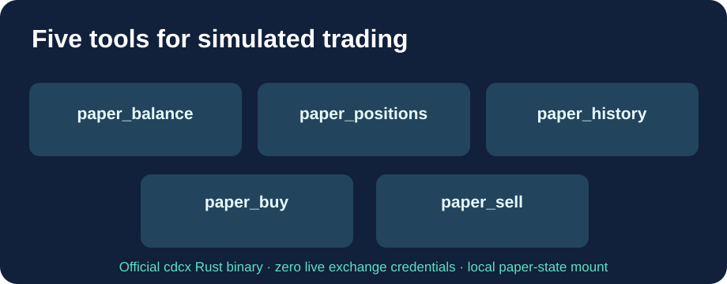

# Cloud9-CDCX-Paper-MCP

**Cinq outils MCP de trading fictif, une image GHCR préconstruite et aucune opération sur de vrais fonds.**

[English](README.md) · Français · [简体中文](README.zh-CN.md)

Le [CDCX officiel de Crypto.com](https://github.com/crypto-com/cdcx-cli) propose déjà un serveur MCP pour l'Exchange, mais **son moteur de paper trading est uniquement accessible en CLI**. Cette distribution ajoute uniquement ses cinq outils MCP manquants, sans modifier le binaire original.

| Outil | Fonction |
|---|---|
| paper_balance | Solde et P&L simulés |
| paper_positions | Positions fictives |
| paper_history | Historique du compte de simulation |
| paper_buy | Achat fictif, prix limite facultatif |
| paper_sell | Vente fictive, prix limite facultatif |

L'achat et la vente modifient **uniquement le simulateur local**. Aucune clé Exchange ou donnée financière personnelle n'est embarquée.

## Fonctions et maintenance

- Binaire officiel vérifié par SHA256, compilé pour amd64 et arm64.
- Cinq outils et schémas de paramètres comparés au contrat de référence par une vraie session MCP HTTP.
- Test du moteur de simulation et protection du serveur contre les hôtes DNS non autorisés.
- Build et publication GHCR sur GitHub uniquement après succès des tests. Les serveurs utilisateurs ne font que récupérer l'image.
- État du compte fictif conservé dans un volume Docker ; utilisateur non privilégié.

## Installation

~~~bash
git clone https://github.com/GodsQuantum/Cloud9-CDCX-Paper-MCP.git
cd Cloud9-CDCX-Paper-MCP
cp .env.example .env
docker compose -f compose.example.yaml up -d
~~~

Adresse MCP locale : **http://127.0.0.1:18767/mcp**. Pour joindre le service via le réseau Docker, indiquer le nom DNS exact et le port dans MCP_ALLOWED_HOSTS. La protection anti-rebinding reste active ; les hôtes inconnus reçoivent HTTP 421. Ne pas exposer ce serveur sur Internet sans authentification.

Code additionnel sous MIT ; binaire upstream sous double licence MIT / Apache-2.0. Projet communautaire non affilié à Crypto.com.
