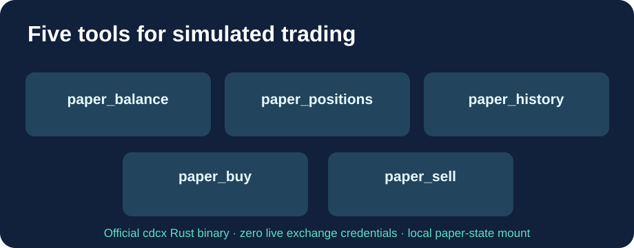

<h1 align="center">Cloud9-CDCX-Paper-MCP</h1>

<strong>Five MCP tools for paper trading. No live Exchange credentials, no server-side compilation.</strong>

English · <a href="README.fr.md">Français</a> · <a href="README.zh-CN.md">简体中文</a>

This community distribution exposes the five paper-trading operations of the **unmodified upstream** [Crypto.com CDCX CLI](https://github.com/crypto-com/cdcx-cli) through a Streamable HTTP MCP server. The official CDCX MCP supports real Exchange API tools, but its **paper engine is CLI-only**; this adapter adds only the missing simulator functionality.

## Five tools

| Tool | Function | Side effect |
|---|---|---|
| paper_balance | Simulated cash balance and profit/loss | Read |
| paper_positions | Open simulated positions | Read |
| paper_history | Paper transaction history | Read |
| paper_buy | Simulated buy, optional limit price | SIMULATION ONLY |
| paper_sell | Simulated sell, optional limit price | SIMULATION ONLY |

No tool uses the live trading or withdrawal commands, and the container does not contain any account credentials. Paper buy/sell changes **only the simulated local state**. When online, the native simulator may consult public market prices.

## What Cloud9 adds beyond official CDCX

- Five MCP paper tools with exactly the same input schemas as the tested production adapter.
- Official upstream **Rust release binary**, SHA256 verified against its official release SHA256 checksum, with amd64 and arm64 support. No patch to CDCX source.
- **Ready-to-pull public GHCR image**. GitHub Actions checks for upstream releases and builds/tests there, not on the local Docker server.
- Native simulator test, real HTTP MCP handshake, all five tool schemas, and explicit Host/DNS security rejection must pass before new releases are published.
- Non-root UID 1000, volume persistence for paper state, and loopback-only port binding by default.

## Quick start

~~~bash
git clone https://github.com/GodsQuantum/Cloud9-CDCX-Paper-MCP.git
cd Cloud9-CDCX-Paper-MCP
cp .env.example .env
docker compose -f compose.example.yaml up -d
~~~

MCP URL: **http://127.0.0.1:18767/mcp**. Simulated account data survives updates in the Docker volume. Initialize the paper simulator using the official CDCX CLI if it is not already configured.

For access from another container, set MCP_ALLOWED_HOSTS to the exact Docker DNS name and port, for example paper-mcp:18767, and use a trusted network and authenticated gateway. The default only accepts localhost. Unknown Host headers are rejected with HTTP 421; DNS rebinding protection remains enabled.

The GitHub release workflow publishes immutable SHA image tags plus latest **only after success**. If an upstream update breaks the contract, no new release is published. Roll back by immutable image digest.

## Privacy and licensing

No user accounts, private IPs, financial records, API tokens or environment files are included in the source or image. Cloud9 additions use MIT; the original Crypto.com CDCX binary retains its MIT / Apache-2.0 dual license. This is a community project, not an official Crypto.com product.
