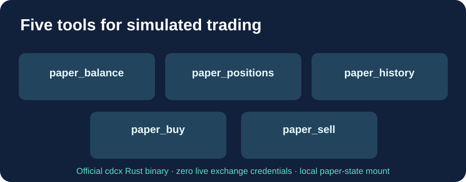

# Cloud9-CDCX-Paper-MCP

**五个模拟交易 MCP 工具、公开的预构建 GHCR 镜像，不涉及真实资金。**

[English](README.md) · [Français](README.fr.md) · 简体中文

Crypto.com 的官方开源 [CDCX CLI](https://github.com/crypto-com/cdcx-cli) 已包含交易所 API MCP 服务器，但其**模拟交易功能仅提供 CLI 命令**。此项目在不修改官方 Rust 二进制的前提下，增加五个模拟交易 MCP 工具。

| 工具 | 功能 |
|---|---|
| paper_balance | 模拟余额及盈亏 |
| paper_positions | 模拟持仓 |
| paper_history | 模拟交易历史 |
| paper_buy | 模拟买入，可指定限价 |
| paper_sell | 模拟卖出，可指定限价 |

买卖操作**只修改本地模拟账户**，不会向交易所提交真实订单。镜像不包含账户密钥。

## Cloud9 提供的增强

- 下载官方 CDCX Release 二进制并验证 SHA256，支持 amd64 / arm64。
- GitHub Actions 自动构建、测试并发布 GHCR 镜像，生产服务器只需拉取。
- 真实 HTTP MCP 测试检查五个工具及参数 Schema、模拟账户读取和 DNS 安全限制。
- 仅在所有测试通过后发布最新镜像；模拟账户存储在持久 Docker 卷中。
- 非特权用户运行，默认只在 localhost 发布端口。

## 安装

~~~bash
git clone https://github.com/GodsQuantum/Cloud9-CDCX-Paper-MCP.git
cd Cloud9-CDCX-Paper-MCP
cp .env.example .env
docker compose -f compose.example.yaml up -d
~~~

本地 MCP 地址：**http://127.0.0.1:18767/mcp**。如果其他容器通过 Docker 网络访问，请通过 MCP_ALLOWED_HOSTS 指定准确的服务名和端口。DNS 重新绑定防护保持开启，未知主机名返回 HTTP 421。不要未经认证就公开 MCP 接口。

新增代码采用 MIT 许可证；官方 CDCX 二进制保留 MIT / Apache-2.0 双重许可。此项目不隶属于 Crypto.com。
